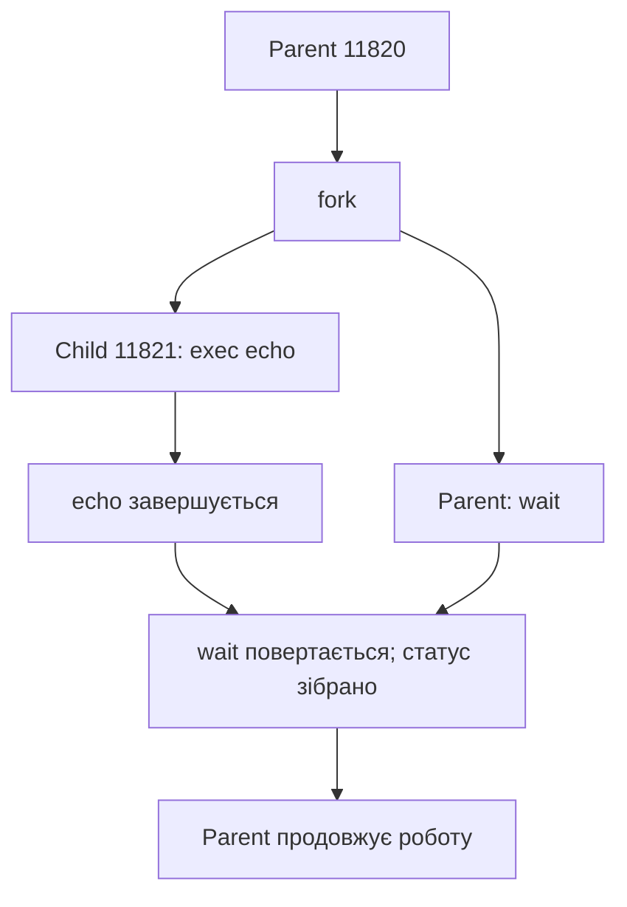
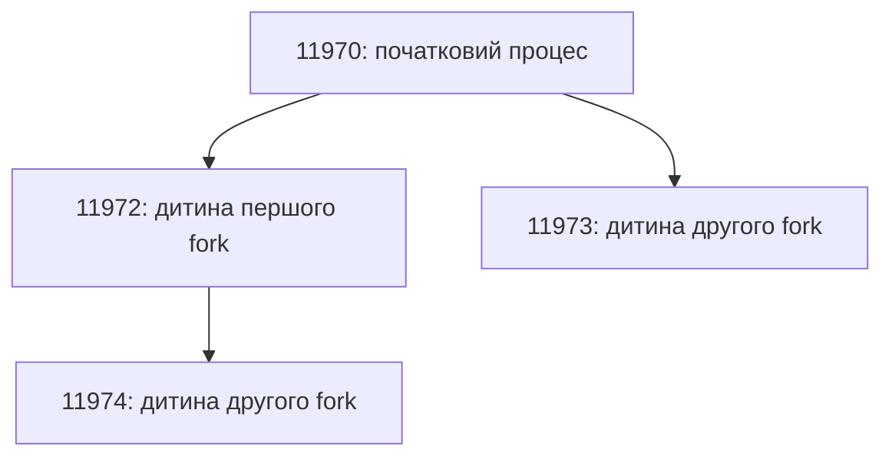

cd /workspaces/eom-labs1.1/labs/lab04-processes && cat > README.md <<'README'
# Лабораторна робота №4
## Процеси, системні виклики та fork() / exec() / wait()

**Виконав:** Платонов Роман Віталійович.  
**Середовище:** GitHub Codespaces 
**Інструменти:** GCC 13.3.0, strace 6.8.  

## 1. Мета роботи

Дослідити процеси та їхні стани, системні виклики, незалежність
пам’яті після fork, заміну програми через exec, очікування завершення
дитини та отримання її exit status.

Усі 14 вихідних файлів скомпільовано з `-Wall -Wextra -O0`.
У журналі компіляції немає повідомлень про помилки чи попередження.

## 2. Прогнози перед запуском

- Три запуски одного executable отримають різні PID.
- fork поверне PID дитини батьківському процесу та 0 дочірньому.
- Порядок виконання parent і child не гарантований.
- У fork_memory parent матиме value=300, child — value=200.
- Після успішного exec PID збережеться.
- wait дозволить отримати код завершення дитини 42.
- Завершена дитина без збирання статусу тимчасово стане zombie.
- Два послідовні успішні fork дадуть 4 процеси, три — 8.

## 3. Один executable — декілька процесів

`file process_info` визначив ELF 64-bit LSB PIE executable,
x86-64, dynamically linked.

Три instances запущено у фоні з однієї оболонки:

| Instance | PID | PPID | State |
|---|---:|---:|---|
| 1 | 11469 | 11383 | S |
| 2 | 11470 | 11383 | S |
| 3 | 11471 | 11383 | S |

Батьківський процес — `bash`, PID **11383**, PPID **1377**.

Program — файл із кодом на файловій системі.
Process — запущений екземпляр програми з власними PID, станом
і адресним простором. PID призначається процесу, тому один
executable може одночасно виконуватися кількома процесами.

## 4. Спостереження через /proc

| Інформація | Результат |
|---|---|
| Name | process_info |
| PID | 11469 |
| PPID | 11383 |
| State | S (sleeping) |
| Executable | `/tmp/eom-lab04/process_info` |
| Threads | 1 |
| VmSize | 2684 kB |
| VmRSS | 1748 kB |

`cmdline` містив шлях запуску, `exe` посилався на executable.
У `maps` знайдено області executable, libc, завантажувача,
`[heap]` і `[stack]`.

`/proc/PID` — інтерфейс ядра для отримання інформації про процес,
а не сам процес. Після завершення та збирання статусу
`/proc/11469` зник.

Для zombie запис може залишатися до збирання статусу.
У подальшому PID може бути використаний повторно.

## 5. System calls: printf та write

Повторна компіляція та перевірка підтвердили:

```text
write(1, "Hello from process!\n", 20) = 20
```

- `1` — файловий дескриптор stdout.
- Другий аргумент — дані для запису.
- `20` — запитана кількість байтів, включно з переведенням рядка.
- Повернене `20` — фактично записана кількість байтів.

Для output.c отримано:

```text
write(1, "Output using write\n", 19) = 19
write(1, "Output using printf\n", 20) = 20
```

Перевірка `wc -c` підтвердила 20 байтів у виводі hello
та 39 байтів у виводі output.

Хоча printf викликається першим, під час перенаправлення stdout
його дані буферизуються. write передає дані раніше, а буфер printf
скидається при нормальному завершенні програми.

printf — бібліотечна функція форматованого виведення з буферизацією.
write — інтерфейс запису через системний виклик.
Один printf не обов’язково відповідає одному write.
Під час системного виклику керування передається ядру.

## 6. Результати fork

| Запуск | Parent PID | Child PID | Child PPID | fork у parent | fork у child |
|---|---:|---:|---:|---:|---:|
| 1 | 11762 | 11763 | 1 | 11763 | 0 |
| 2 | 11765 | 11766 | 11765 | 11766 | 0 |
| 3 | 11768 | 11769 | 1 | 11769 | 0 |

До fork був один процес програми; успішний fork створив ще один.
Обидва продовжили виконання після виклику, але отримали різні
повернені значення й виконали різні гілки if.

PPID=1 у двох запусках пояснюється тим, що parent уже завершився,
і child було перепідпорядковано. У цій програмі немає wait.

У трьох запусках повідомлення parent показано раніше child.
Це спостереження не гарантує такого порядку в наступних запусках:
процеси плануються ОС незалежно.

`fflush(stdout)` перед fork запобігає дублюванню вже накопиченого
виводу через копіювання буфера stdio.

### fork у strace

```text
clone(child_stack=NULL, flags=CLONE_CHILD_CLEARTID|CLONE_CHILD_SETTID|SIGCHLD, child_tidptr=0x7396dedc3a10) = 11779
```

C API fork у цьому середовищі реалізовано через kernel interface
clone. `strace -f` стежить також за дочірнім процесом.
Обидва процеси завершилися з кодом 0.

## 7. Незалежність пам’яті

| Процес | PID | value | Адреса value |
|---|---:|---:|---|
| До fork | — | 100 | `0x59cd150d2010` |
| Parent | 11771 | 300 | `0x59cd150d2010` |
| Child | 11772 | 200 | `0x59cd150d2010` |

Прогноз підтверджено: зміна value у parent не змінює value у child.

Однакова числова віртуальна адреса належить різним адресним
просторам. Звичайна глобальна змінна після fork не стає спільною
змінюваною змінною. Linux може спочатку використовувати спільні
фізичні сторінки з механізмом copy-on-write.

## 8. wait та exit status

Фактичний результат:

```text
PARENT: waiting for child 11781
CHILD: working...
CHILD: finished
PARENT: child finished
PARENT: child exit status = 42
```

Parent очікує завершення child, якщо він ще працює.
Після завершення wait збирає його статус.

42 — код нормального завершення, а не PID.
`WIFEXITED(status)` перевіряє нормальне завершення,
`WEXITSTATUS(status)` отримує код лише після такої перевірки.

Повідомлення `PARENT: child finished` виводиться після успішного wait.

## 9. exec та збереження PID

Запуск echo:

```text
Before exec: PID=11818
Hello from exec!
```

Запуск допоміжної програми pid_after_exec:

```text
Before exec: PID=11819
New program PID=11819
```

PID залишився **11819**. exec не створив новий процес,
а замінив його program image.
Після успішного exec повернення до старого коду не відбувається.
Код із perror виконується лише у випадку помилки exec.

## 10. fork → exec → wait

У fork_exec parent мав PID **11820**, child — **11821**.
Child запустив echo, після чого parent вивів
`PARENT: child completed`.



- fork створює child.
- exec замінює програму child.
- wait синхронізує parent із завершенням child і збирає статус.

Launcher перевірено командами date, whoami та uname:

| Програма | Child PID | Результат | Exit status |
|---|---:|---|---:|
| date | 11823 | Дата й час у UTC | 0 |
| whoami | 11825 | codespace | 0 |
| uname | 11827 | Linux | 0 |

## 11. Process states та zombie

Під час sleep процес states мав PID **11828**, PPID **11383**
і стан **S (sleeping)**. Він очікував таймер і не виконував
активний цикл, що витрачав би CPU.

### До wait

```text
PID    PPID   STATE  COMMAND
11840  11383  S      /tmp/eom-lab04/zombie
11842  11840  Z      [zombie] <defunct>
```

Child завершив виконання, але parent протягом 5 секунд
не збирав статус. Тому child залишався у стані Z.

Після waitpid запис дитини в /proc зник.

### Негайний wait

Parent **11917** зібрав статус child **11919** перед sleep.
Під час спостереження залишився лише sleeping parent;
zombie child уже не було.

Zombie не виконує інструкцій: зберігається запис про завершення,
потрібний для отримання статусу.

Для скорочення експерименту використано 5 секунд замість 60.
Після періоду спостереження статус збирається автоматично.

## 12. Два та три fork

Прогноз: 4 процеси після двох fork і 8 після трьох,
якщо всі виклики успішні та виконуються всіма створеними процесами.

Фактичне дерево для двох fork:



| Кількість fork | Прогноз | Рядків PID у результаті |
|---|---:|---:|
| 2 | 4 | 4 |
| 3 | 8 | 8 |

Прогноз підтверджено. Загальна кількість — `2^n`,
кількість нових процесів — `2^n - 1`.

У fork_count після друку PID кожен процес очікує власних дітей.
Це дозволяє зібрати їхні статуси й не змінює кількості процесів.

## 13. Фінальна програма process_runner

Програма перевіряє аргументи, друкує PID parent, створює child,
показує його PID/PPID, виконує execlp і очікує через waitpid.

Оброблено помилки fork, exec і waitpid.
При EINTR очікування повторюється.
Перевіряються нормальне завершення та завершення сигналом.

| Перевірка | Parent / child PID | Результат |
|---|---|---|
| date | 11986 / 11987 | Exit status 0; parent продовжив роботу |
| false | 11988 / 11989 | Exit status 1; runner повернув 1 |
| Неіснуючий шлях | 11990 / 11991 | Помилка exec; exit status 127 |
| Без аргументів | — | Usage; код 1 |

Код 127 задано нашою програмою для помилки exec.
Виклик `_exit` у child завершує його без повторного скидання
успадкованих буферів stdio.

Гілки помилок fork/waitpid і завершення сигналом реалізовано,
але наведені запуски не провокували ці ситуації.

### Три фрагменти strace

Нижче прибрано сторонній вивід, що перемішався з trace;
довгі аргументи скорочено через `...`.

**1. Створення child:**

```text
clone(child_stack=NULL, flags=CLONE_CHILD_CLEARTID|CLONE_CHILD_SETTID|SIGCHLD, ...) = 11997
```

**2. Заміна program image у child:**

```text
[pid 11997] execve("/usr/bin/date", ["date"], ...) = 0
```

**3. Очікування та завершення:**

```text
[pid 11996] wait4(11997, ... <unfinished ...>
[pid 11997] exit_group(0) = ?
[pid 11997] +++ exited with 0 +++
<... wait4 resumed>[{WIFEXITED(s) && WEXITSTATUS(s) == 0}], 0, NULL) = 11997
```

У цьому середовищі fork відповідає clone, execlp — викликам execve,
а waitpid — wait4.

Попередні невдалі execve з ENOENT відображають пошук date
у каталогах PATH. Пошук завершився успішним `/usr/bin/date`.

## 14. Команди для відтворення

Виконувати у Bash з папки лабораторної. Потрібні GCC і strace.
PID, адреси, час і порядок частини повідомлень можуть відрізнятися.

```bash
mkdir -p /tmp/eom-lab04
b=/tmp/eom-lab04
for src in *.c; do
    gcc -Wall -Wextra -O0 "$src" -o "$b/${src%.c}" || break
done

file "$b/process_info"
"$b/process_info" & p1=$!
"$b/process_info" & p2=$!
"$b/process_info" & p3=$!
sleep 1
ps -o pid,ppid,state,comm,args -p "$p1,$p2,$p3"
ls "/proc/$p1"
tr '\0' ' ' < "/proc/$p1/cmdline"
echo
cat "/proc/$p1/status"
readlink "/proc/$p1/exe"
head -n 20 "/proc/$p1/maps"
wait "$p1" "$p2" "$p3"
test ! -d "/proc/$p1" && echo "Process entry removed"

# Повторна звірка write із source; stdout спрямовано у файл.
gcc -Wall -Wextra -O0 hello.c -o "$b/hello"
gcc -Wall -Wextra -O0 output.c -o "$b/output"
strace -e write -o "$b/hello.trace" "$b/hello" > "$b/hello.txt"
cat "$b/hello.trace"
wc -c "$b/hello.txt"
strace -e write -o "$b/output.trace" "$b/output" > "$b/output.txt"
cat "$b/output.trace"
cat "$b/output.txt"

for run in 1 2 3; do
    "$b/fork_basic"
    sleep 0.2
done
"$b/fork_memory"
sleep 0.2
strace -f -e trace=process "$b/fork_basic"

"$b/wait_basic"
"$b/exec_basic"
"$b/exec_basic" "$b/pid_after_exec"
"$b/fork_exec"
"$b/launcher" date
"$b/launcher" whoami
"$b/launcher" uname

"$b/states" &
p=$!
sleep 1
ps -o pid,ppid,state,cmd -p "$p"
grep -E '^(Name|State|Pid|PPid):' "/proc/$p/status"
kill "$p"
wait "$p"

"$b/zombie" &
p=$!
sleep 1
ps -o pid,ppid,state,cmd -p "$p" --ppid "$p"
wait "$p"

"$b/zombie" wait &
p=$!
sleep 1
ps -o pid,ppid,state,cmd -p "$p" --ppid "$p"
wait "$p"

"$b/fork_count" 2
"$b/fork_count" 3

"$b/process_runner" date
echo "Runner code: $?"
"$b/process_runner" false
echo "Runner code: $?"
"$b/process_runner" /definitely-not-existing-lab04-program
echo "Runner code: $?"
"$b/process_runner"
echo "Runner code: $?"
strace -f -e trace=process "$b/process_runner" date
```

Ненульові коди для false, неіснуючої програми, відсутнього аргументу
та завершеного сигналом states є очікуваними в цих перевірках.

## 15. Контрольні питання

1. **Program і process:** program — файл із кодом; process — запущений екземпляр із власним станом.
2. **PID:** ідентифікатор процесу.
3. **PPID:** ідентифікатор батьківського процесу.
4. **Один executable і декілька PID:** кожен запуск створює окремий процес.
5. **/proc/PID:** інтерфейс отримання інформації ядра про процес.
6. **System call:** контрольований запит програми до сервісів ядра.
7. **Function call і system call:** звичайний виклик функції сам по собі не вимагає переходу в kernel mode; системний виклик передає керування ядру.
8. **strace:** показує системні виклики, їхні аргументи, результати й сигнали.
9. **fork:** створює дочірній процес, що продовжує виконання після виклику.
10. **Після одного fork:** два процеси цієї програми, якщо виклик успішний.
11. **0 у child:** визначене API значення для розрізнення гілок parent і child.
12. **Результат у parent:** PID створеної дитини; при помилці — -1.
13. **Змінна value:** parent і child мають окремі змінювані копії звичайної глобальної змінної.
14. **Однакові virtual addresses:** інтерпретуються в різних адресних просторах; copy-on-write зберігає незалежність змін.
15. **exec:** замінює поточний program image.
16. **Чи створює exec процес:** ні.
17. **PID після exec:** зберігається.
18. **wait:** очікує завершення дитини, якщо потрібно, і збирає її статус.
19. **Exit status:** код нормального завершення, який отримує parent; це не PID.
20. **Zombie:** завершений процес, статус якого ще не зібрано.
21. **Інструкції zombie:** не виконуються.
22. **Ready / Running / Waiting:** готовий до CPU / виконується на CPU / очікує подію. У Linux позначення R охоплює running або runnable.
23. **Порядок parent/child:** визначається планувальником і не гарантується без синхронізації.
24. **Зв’язок із shell:** оболонка може створити child через fork, запустити команду через exec і зібрати її статус через wait.

## Висновок

Досліджено PID/PPID, /proc, sleeping і zombie states.
Підтверджено різні результати fork у parent і child, незалежність
їхньої пам’яті, збереження PID після exec та отримання exit status
через wait. Два і три fork дали відповідно 4 і 8 процесів.
Створено process_runner та зіставлено його C API з clone,
execve і wait4 у strace. Повторна перевірка write підтвердила кількість записаних байтів.
