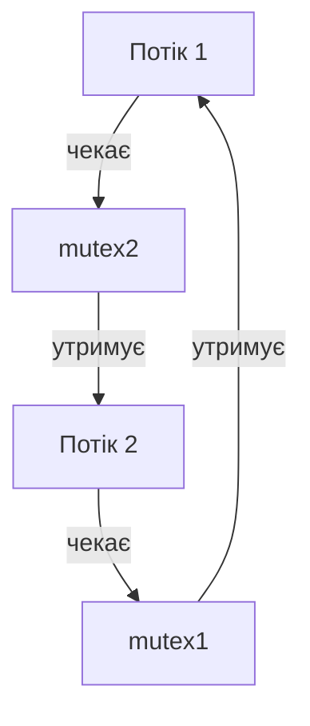

# Лабораторна робота №5
## Потоки, Race Conditions та Mutex

**Курс:** Архітектура ЕОМ, операційні системи та системне програмування  
**Виконав:** Платонов Роман Віталійович

## 1. Мета роботи

Дослідити створення POSIX threads, спільні та локальні дані потоків,
race condition, взаємне виключення за допомогою mutex і deadlock.
Реалізувати паралельне обчислення суми з локальним накопиченням результатів.

## 2. Відтворення та артефакти

З кореня репозиторію:

```bash
cd labs/lab05-threads
bash run.sh
```

Використані параметри компіляції:

```bash
gcc -std=c11 -Wall -Wextra -O0 -pthread program.c -o /tmp/lab05-program
```

Потрібні GCC, pthreads, Bash, objdump і timeout. Заголовок
`thread_check.h` має бути поряд із файлами `.c`: він перевіряє коди
помилок pthread-функцій. Ці функції повертають код помилки безпосередньо.

Збережені матеріали:

- [Журнал експериментів](lab05-results.txt) — результати повторних запусків і вимірювання часу.
- [Артефакти](artifacts/) — Assembly `.s` і повне дизасемблювання `.objdump.txt`.
- [Команди створення артефактів](artifacts/build-commands.txt).
- [Дизасемблювання increment()](artifacts/race-increment.txt).
- [Повне дизасемблювання race](artifacts/race.objdump.txt).
- [Assembly race](artifacts/race.s).

`run.sh` створює виконувані файли в тимчасовому каталозі та видаляє
його після завершення. Шляхи до цього каталогу в журналі команд
описують конкретний запуск; для повторення всіх експериментів слід
використати `bash run.sh`.

Deadlock запускається через `timeout`: після п'яти секунд процес
зупиняється. Скрипт очікує завершення команди; фонові процеси не залишаються.
Виконувані файли та screenshots до роботи не додаються.

## 3. Прогнози перед запуском

1. Новий потік працюватиме в тому самому процесі та адресному просторі.
2. Порядок виконання потоків не обов'язково збігатиметься з порядком створення.
3. Глобальна змінна буде спільною, а локальні змінні worker-функцій
   матимуть різні адреси у стеках потоків.
4. Незахищений `counter++` може призводити до втрачених оновлень.
   Формально data race означає undefined behavior у C.
5. За правильного використання mutex очікуваний результат — 2000000.
6. Для shared heap очікувана зміна — 100 → 110; квадрат числа 12 — 144.
7. Різний порядок захоплення двох mutex може створити circular wait.
8. Очікувана сума чисел від 1 до 1000000 — 500000500000.
   Чотири потоки не обов'язково прискорять настільки мале обчислення.

## 4. Перший потік

Фактичний вивід `first_thread.c`:

```text
Main: creating thread
Hello from worker thread!
Main: worker finished
```

Програма працює в одному процесі та не створює дочірніх процесів.
`pthread_create()` створює worker, що виконує функцію `worker()`.
У програмі є main thread і один створений worker; worker може завершитися
ще до повернення main із `pthread_create()`.

`pthread_join()` очікує завершення worker. Тому повідомлення main
про завершення worker виводиться після повідомлення worker.
Окремий адресний простір для нового потоку не створюється.

## 5. Порядок виконання декількох потоків

Результати п'яти запусків `multiple_threads.c`:

| Запуск | Порядок повідомлень потоків |
|---|---|
| 1 | 1 → 3 → 4 → 2 |
| 2 | 1 → 2 → 3 → 4 |
| 3 | 1 → 2 → 3 → 4 |
| 4 | 2 → 1 → 4 → 3 |
| 5 | 1 → 2 → 3 → 4 |

Порядок повідомлень змінювався. Порядок викликів `pthread_create()`
не визначає порядок виконання worker-функцій.
Кожен worker отримує адресу окремого елемента `ids[]`, який існує
до завершення всіх потоків.

## 6. Спільні дані та стеки

### Глобальна змінна

У першому запуску `shared_data.c` адреса `value` в обох worker
і main була однаковою: `0x5ce7c0f8402c`.

| Запуск | Значення value, прочитане main після join |
|---|---:|
| 1 | 100 |
| 2 | 200 |
| 3 | 100 |
| 4 | 200 |
| 5 | 200 |

Програма навмисно містить несинхронізовані конфліктні звернення до
глобальної змінної. Це data race та undefined behavior у C.
Наведені числа — спостереження конкретних запусків, а не гарантований
перелік можливих результатів. `printf()` не захищає окремі звернення
до `value`, а `pthread_join()` не усуває race між worker-потоками.

### Локальні змінні

| Запуск | Адреса local потоку 1 | Адреса local потоку 2 |
|---|---|---|
| 1 | `0x70810905eeb0` | `0x70810885deb0` |
| 2 | `0x77ac2f0feeb0` | `0x77ac2e8fdeb0` |
| 3 | `0x70be137c4eb0` | `0x70be12fc3eb0` |

Значення становили відповідно 10 і 20. Адреси різні, оскільки потоки
мають окремі стеки. Стеки залишаються частиною спільного адресного
простору: передача вказівника може зробити локальний об'єкт доступним
іншому потоку, якщо забезпечено його час життя та синхронізацію.

Потоки поділяють код, глобальні дані й heap.
На відміну від них, процеси після звичайного `fork()` мають окремі
адресні простори: зміна звичайної глобальної змінної в одному процесі
не змінює її в іншому. Однакові числові адреси в різних процесах
самі по собі не означають спільну пам'ять.

## 7. Race condition: два та чотири потоки

Два потоки виконують по 1000000 збільшень; чотири — по 500000.
В обох випадках математично очікується 2000000.

| Запуск | race: 2 потоки | race_four: 4 потоки |
|---|---:|---:|
| 1 | 1580061 | 1076841 |
| 2 | 2000000 | 1162992 |
| 3 | 1523573 | 923439 |
| 4 | 1049881 | 1536212 |
| 5 | 2000000 | 1340159 |

Без mutex результати нестабільні. У двох запусках `race.c` результат
випадково збігся з очікуваним, але програма від цього не стала коректною.
У серії з чотирма потоками всі п'ять результатів відрізнялися від очікуваного.
Це не доводить універсальної залежності величини помилки від кількості потоків.

### Приклад lost update

Початкове значення лічильника — 100.

| Крок | Потік A | Потік B | counter |
|---|---|---|---:|
| 1 | Читає 100 | — | 100 |
| 2 | — | Читає 100 | 100 |
| 3 | Обчислює 101 | — | 100 |
| 4 | — | Обчислює 101 | 100 |
| 5 | Записує 101 | — | 101 |
| 6 | — | Записує 101 | 101 |

Два збільшення дали 101 замість 102: одне оновлення втрачено.
Це ілюстрація можливого виконання машинних операцій; на рівні C
наявність data race означає undefined behavior, а не лише втрату оновлень.

## 8. Машинні інструкції counter++

Фрагмент фактичного дизасемблювання, синтаксис AT&T:

```asm
126c: 48 8b 05 bd 2d 00 00   mov 0x2dbd(%rip),%rax  # 4030 <counter>
1273: 48 83 c0 01            add $0x1,%rax
1277: 48 89 05 b2 2d 00 00   mov %rax,0x2db2(%rip)  # 4030 <counter>
127e: 83 45 fc 01            addl $0x1,-0x4(%rbp)
1282: 81 7d fc 3f 42 0f 00   cmpl $0xf423f,-0x4(%rbp)
1289: 7e e1                  jle 126c <increment+0x15>
```

Перші три інструкції реалізують:

1. Читання `counter` з пам'яті в регістр.
2. Додавання одиниці.
3. Запис результату в пам'ять.

Наступні інструкції збільшують локальний індекс циклу, порівнюють його
з 999999 і виконують перехід. Вони не є додатковими збільшеннями `counter`.

Операція read–modify–write не захищена від іншого потоку.
Навіть атомарність окремого читання або запису не робить атомарною
всю послідовність. `-O0` використано для наочного аналізу;
ця опція не усуває data race.

Повний контекст функції, решта інструкцій програми та машинні байти
збережені в `artifacts/race.objdump.txt`, а вихідний Assembly —
в `artifacts/race.s`.

## 9. Захист лічильника mutex

Критична секція:

```c
CHECK(pthread_mutex_lock(&mutex));
counter++;
CHECK(pthread_mutex_unlock(&mutex));
```

| Запуск | mutex_counter: 2 потоки | mutex_four: 4 потоки | coarse_mutex |
|---|---:|---:|---:|
| 1 | 2000000 | 2000000 | 2000000 |
| 2 | 2000000 | 2000000 | 2000000 |
| 3 | 2000000 | 2000000 | 2000000 |
| 4 | 2000000 | 2000000 | 2000000 |
| 5 | 2000000 | 2000000 | 2000000 |

Один спільний mutex дозволяє лише одному потоку виконувати
критичну секцію одночасно та забезпечує потрібну синхронізацію пам'яті.
Main читає лічильник після `pthread_join()` усіх worker.

У `coarse_mutex.c` mutex захоплюється один раз перед усім циклом.
Результат правильний, але цикли виконуються послідовно.
Для цієї задачі це зменшує витрати на lock/unlock;
у загальному випадку велика критична секція обмежує concurrency.

## 10. Вимірювання часу

Окрема серія з трьох запусків. Наведено `real` у секундах;
`user`, `sys` та результати цих запусків є в повному журналі.

| Програма | Запуск 1 | Запуск 2 | Запуск 3 |
|---|---:|---:|---:|
| race | 0.010 | 0.008 | 0.006 |
| mutex_counter | 0.085 | 0.089 | 0.097 |
| race_four | 0.011 | 0.014 | 0.011 |
| mutex_four | 0.103 | 0.114 | 0.113 |
| coarse_mutex | 0.006 | 0.007 | 0.006 |
| sequential_sum | 0.004 | 0.003 | 0.003 |
| parallel_sum | 0.003 | 0.004 | 0.003 |

Lock/unlock на кожній ітерації додає накладні витрати.
Чотири потоки зі спільним mutex у цих вимірюваннях були повільнішими
за два: доступ до лічильника все одно серіалізований, виникає contention.

Швидкість некоректного `race` не робить його допустимою альтернативою.
Вимірювання короткі, включають запуск процесу, створення потоків і вивід.
Вони ілюстративні; трьох запусків недостатньо для строгого benchmark.

## 11. Спільний heap та повернення результату

У `shared_heap.c` отримано:

```text
Main before: value=100, heap address=0x5e3f3d3a72a0
Worker: value=110, heap address=0x5e3f3d3a72a0
Main after: value=110, heap address=0x5e3f3d3a72a0
```

Main і worker звертаються до одного об'єкта в heap.
Main ініціалізує його до створення worker та читає після join,
тому в цьому прикладі немає одночасних конфліктних звернень.
Після завершення worker main звільняє об'єкт через `free()`.
Для декількох одночасних writer потрібна синхронізація.

У `thread_result.c` отримано `Input=12 Result=144`.
Worker виділяє пам'ять, записує результат і повертає вказівник.
Main отримує його через `pthread_join()`, перевіряє на NULL,
друкує значення та виконує `free()`.

Повернення адреси звичайної локальної змінної було б помилкою:
її час життя завершується при виході з worker-функції.
Heap-об'єкт існує до явного звільнення.

## 12. Deadlock і виправлення

Фактично спостерігалося:

```text
Thread 1: acquired mutex1
Thread 2: acquired mutex2
Thread 1: locking mutex2
Thread 2: locking mutex1
Exit=124
```

Обидва потоки утримують по одному mutex і очікують ресурс,
який може звільнити лише інший заблокований потік.



Код 124 означає завершення через timeout. Разом із повідомленнями
про захоплені mutex та порядком блокувань це підтверджує відтворення
очікуваного circular wait.

У `deadlock_fixed.c` обидва потоки захоплюють mutex в одному порядку:
спочатку mutex1, потім mutex2; звільняють у зворотному порядку.

Обидва потоки виконали critical section, після чого отримано:

```text
Main: both workers finished
```

Єдиний порядок захоплення усуває circular wait для цих двох mutex.

### Race condition та deadlock

| Характеристика | Race condition | Deadlock |
|---|---|---|
| Потоки продовжують виконання? | У досліді так; для C data race гарантій немає | Потоки в циклі очікування не просуваються |
| Можливий неправильний результат? | Так | Результат може взагалі не бути отриманий |
| Програма може перестати просуватися? | Не обов'язково; undefined behavior не дає гарантій | Так, якщо завершення залежить від заблокованих потоків |
| Залежить від timing/order? | Прояв помилки може залежати | Виникнення циклу може залежати |
| Mutex може допомогти? | Так, за правильного захисту всіх конфліктних звернень | Потрібна правильна схема захоплення, а не просто додатковий mutex |
| Неправильне використання mutex може бути причиною? | Так: пропущений захист або різні locks для тих самих даних | Так: циклічний порядок захоплення |

## 13. Parallel Sum

Діапазон від 1 до 1000000 розділено між чотирма потоками.

| Потік | Діапазон | Часткова сума |
|---|---|---:|
| 1 | 1–250000 | 31250125000 |
| 2 | 250001–500000 | 93750125000 |
| 3 | 500001–750000 | 156250125000 |
| 4 | 750001–1000000 | 218750125000 |

У всіх трьох основних запусках:

```text
Parallel result: 500000500000
Expected result: 500000500000
Correct: YES
```

Перевірка: `N × (N + 1) / 2 = 500000500000`.
Послідовна програма також дала цей результат у всіх трьох запусках.

### Shared та local data

- Масив `tasks[]` розміщений у стеку main, але його елементи доступні worker через вказівники.
- Кожен worker отримує власний елемент Task і записує лише його поле `result`.
- `local_sum` та індекс циклу — локальні змінні відповідного worker.
- Main читає результат конкретного worker лише після успішного `pthread_join()` цього потоку.
- Підсумковий `total` змінює тільки main.

Mutex у циклі не потрібний: потоки не змінюють один спільний
накопичувач. Запис результатів у різні елементи масиву не створює
data race. Такий підхід зменшує кількість операцій синхронізації.

Порядок друку часткових результатів тут визначає main,
а не порядок завершення worker-потоків.

За виміряним часом переконливого прискорення не отримано:
обидві версії мали `real` 0.003–0.004 с.
Паралелізація доцільна, коли незалежної обчислювальної роботи достатньо,
щоб перекрити витрати на створення потоків і синхронізацію.

## 14. Межі значень і коректність

Лічильники використовують фіксовані параметри завдання:
2000000 сумарних збільшень. Для коректно синхронізованих версій
це значення вкладається в тип `long`.

Сума та її формула обчислюються в `long long`; `N` задано
як `1000000LL`, тому проміжне множення також виконується в цьому типі.
За цього N індекси циклів і всі проміжні суми не переповнюються.

Ці програми не заявляють підтримки довільних значень до межі типу.
При зміні N потрібна повторна перевірка множення, накопичення
та збільшення індексу циклу. Для навмисних програм із data race
арифметичні межі не усувають undefined behavior.

## 15. Контрольні питання

1. **Що таке thread?**  
   Потік виконання всередині процесу з власним контекстом виконання.

2. **Чим thread відрізняється від process?**  
   Процес має власний адресний простір і ресурси; потоки одного процесу
   поділяють його адресний простір.

3. **Що потоки одного процесу поділяють?**  
   Код, глобальні дані, heap та ресурси процесу, зокрема відкриті файлові дескриптори.

4. **Що кожен потік має власне?**  
   Регістри, позицію виконання, стек, стан планування та thread-local storage.

5. **Чи має кожен потік власний stack?**  
   Так. Він використовується для викликів функцій і локальних даних.

6. **Чи мають потоки спільний heap?**  
   Так, heap належить спільному адресному простору.

7. **Для чого pthread_create()?**  
   Створює потік, який починає виконання заданої функції з переданим аргументом.

8. **Для чого pthread_join()?**  
   Очікує завершення потоку, дозволяє отримати його результат і синхронізує
   доступ до результатів завершеного потоку.

9. **Чи гарантується порядок виконання порядком pthread_create()?**  
   Ні, фактичне виконання залежить від планування.

10. **Concurrency та parallelism — у чому різниця?**  
    Concurrency — просування декількох задач протягом спільного проміжку часу,
    зокрема через чергування; parallelism — їх одночасне виконання.

11. **Що таке shared state?**  
    Дані, доступні декільком потокам, особливо ті, які можуть змінюватися.

12. **Що таке race condition?**  
    Помилка, за якої коректність залежить від порядку або моменту виконання
    конкурентних операцій. Data race — конкретний випадок конфліктних
    несинхронізованих доступів, що для звичайних об'єктів у C означає undefined behavior.

13. **Що таке lost update?**  
    Втрата зміни, коли один запис перезаписує результат іншого оновлення.

14. **Чому counter++ не слід вважати atomic?**  
    Для звичайного спільного counter це read–modify–write без гарантії
    неподільності; у досліді використано три машинні інструкції.

15. **Що таке critical section?**  
    Ділянка роботи зі спільним станом, яка потребує узгодженого доступу.

16. **Що таке mutual exclusion?**  
    Гарантія, що захищену ділянку одночасно виконує не більше одного потоку.

17. **Що таке mutex?**  
    Об'єкт синхронізації для організації взаємного виключення.

18. **Що робить pthread_mutex_lock()?**  
    Захоплює mutex або очікує можливості його захопити.

19. **Що відбувається, якщо mutex належить іншому потоку?**  
    Потік, який викликає звичайний блокувальний lock, очікує його доступності.

20. **Навіщо pthread_mutex_unlock()?**  
    Звільняє mutex після завершення захищеної роботи.

21. **Чому велика critical section може погіршити concurrency?**  
    Інші потоки довше очікують, а більша частина роботи серіалізується.

22. **Що таке lock contention?**  
    Конкуренція декількох потоків за один lock.

23. **Чому більше потоків не обов'язково дає кращу performance?**  
    Додаються витрати на створення, планування, синхронізацію та конкуренцію
    за ресурси; частина роботи може залишатися послідовною.

24. **Що таке deadlock?**  
    Стан, коли група потоків не може просуватися через взаємне очікування ресурсів.

25. **Чим deadlock відрізняється від race condition?**  
    Deadlock блокує просування; race condition порушує коректність через
    залежність від взаємного порядку операцій.

26. **Що таке circular wait?**  
    Цикл очікувань, у якому кожен учасник очікує ресурс, утримуваний наступним.

27. **Як однаковий порядок отримання locks запобігає deadlock?**  
    Узгоджений глобальний порядок захоплення усуває цикли очікування цих locks.

28. **Що таке starvation?**  
    Тривале або необмежене ненадання потоку потрібного ресурсу,
    хоча інші потоки продовжують виконання.

29. **Чому local accumulation кращий за shared counter з mutex на кожній ітерації?**  
    Потоки працюють із власними накопичувачами, а результати об'єднуються
    після завершення: значно менше синхронізації та contention.

30. **Чому 100 успішних запусків не доводять відсутності race condition?**  
    Тести охоплюють лише частину можливих порядків виконання.
    Коректність також потребує аналізу спільних даних, синхронізації та часу життя об'єктів.

## 16. Висновок

Експериментально спостережено різний порядок виконання потоків,
спільність глобальних даних і heap та окремі локальні змінні у стеках.
Незахищений лічильник давав нестабільні результати; mutex забезпечив
очікувані 2000000 у всіх досліджених запусках.

Різний порядок захоплення mutex призвів до deadlock, а узгоджений
порядок усунув circular wait. Паралельне сумування з локальними
накопичувачами дало 500000500000 без mutex у циклі.
Вимірювання показали, що додавання потоків саме по собі не гарантує прискорення.
