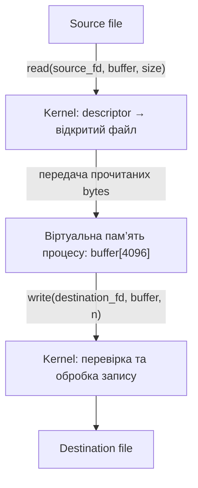

# Лабораторна робота №6
## Віртуальна пам’ять, File Descriptors та I/O

**Курс:** Архітектура ЕОМ, операційні системи та системне програмування  
**Виконав:** Платонов Роман Віталійович

## 1. Мета роботи

Дослідити віртуальні адреси, mappings процесу, сторінки пам’яті,
memory protection, файлові дескриптори, POSIX I/O та буферизацію.
Реалізувати копіювання файлів з обробкою помилок і partial writes.

## 2. Відтворення та збережені результати

З кореня репозиторію:

```bash
cd labs/lab06-memory-io
bash run.sh
```

Параметри компіляції:

```text
-std=c11 -D_POSIX_C_SOURCE=200809L -Wall -Wextra -O0
```

Потрібні GCC, Python 3, Bash, strace, objdump, getconf та cmp.

- Повний журнал запусків.
- Карти пам’яті, traces та Assembly.
- Команди компіляції.
- Скрипт відтворення.

Виконувані та тестові файли створюються в тимчасовому каталозі поза
репозиторієм. Після експериментів цей каталог видаляється.
Абсолютні тимчасові шляхи в журналі описують конкретний запуск.

Для спостереження процесів використано очікування Enter замість
фіксованого sleep. Скрипт читає /proc, надсилає Enter і очікує
завершення процесу. У разі помилки виконує terminate, за потреби kill,
та обов’язково wait.

`io_helpers.h` містить спільну обробку EINTR, partial write та close.
`file_offset_seek.c` і `buffering_flush.c` зберігають змінені версії
дослідів окремо від початкових.

## 3. Прогнози перед запуском

1. Адреси є віртуальними та можуть відрізнятися між запусками.
2. Код, глобальні дані, heap і stack належатимуть відповідним mappings.
3. Page size потрібно визначити експериментально.
4. Після запису по сторінках очікую збільшення VmRSS.
5. Розіменування NULL є undefined behavior; у цьому досліді очікую SIGSEGV.
6. Стандартні descriptors — 0, 1, 2; open часто повертає 3, але не обов’язково.
7. Послідовні read по 5 bytes дадуть `Compu` та `ter S`.
   Після lseek до початку другий read знову дасть `Compu`.
8. Без fflush можливий вивід `DABC`; після fflush очікую `ABCD`.
9. Копіювання повинно зберігати всі bytes текстових і binary files.

## 4. Розташування даних програми

Результати `memory_layout.c`:

| Об’єкт | Run 1 | Run 2 | Run 3 |
|---|---|---|---|
| function | `0x6157be4261c9` | `0x626f711731c9` | `0x55c5b84781c9` |
| initialized global | `0x6157be429010` | `0x626f71176010` | `0x55c5b847b010` |
| uninitialized global | `0x6157be42901c` | `0x626f7117601c` | `0x55c5b847b01c` |
| static | `0x6157be429014` | `0x626f71176014` | `0x55c5b847b014` |
| heap allocation | `0x6157c93312a0` | `0x626fad1ba2a0` | `0x55c5bffef2a0` |
| local variable | `0x7ffe0753e0ac` | `0x7ffdef20429c` | `0x7ffc5e591bec` |

Глобальні та static-змінна розташовані близько одна до одної.
У першому запуску static розміщена на 4 bytes після initialized global,
а uninitialized global — на 12 bytes після неї.

Heap allocation має окрему адресу; схожість початку числових адрес
не означає належності до того самого mapping. Stack знаходиться
в іншій області адресного простору.

Адреси змінювалися між запусками, що узгоджується з рандомізацією
адресного простору. Це віртуальні адреси процесу, а не прямі адреси
фізичної RAM. За цими запусками не можна встановити універсальний
порядок усіх областей пам’яті.

## 5. Зіставлення з /proc/PID/maps

Для процесу `memory_maps`, PID 7731:

| Об’єкт | Адреса | Mapping: початок–кінець | Права |
|---|---|---|---|
| main | `0x55f230cdd2b7` | `55f230cdd000–55f230cde000` | `r-xp` |
| global | `0x55f230ce0010` | `55f230ce0000–55f230ce1000` | `rw-p` |
| heap | `0x55f2352822a0` | `55f235282000–55f2352a3000` | `rw-p` |
| stack | `0x7fff2cce05e8` | `7fff2ccc1000–7fff2cce3000` | `rw-p` |

Кожна адреса задовольняє умову `start ≤ address < end`:
верхня межа mapping не входить до діапазону.

Адреса heap allocation потрапила до `[heap]`, а локальна змінна —
до `[stack]`. Код main належить executable mapping програми,
global — writable mapping того самого виконуваного файла.

У карті також є mappings спільної бібліотеки `libc.so.6` і
динамічного завантажувача. Наприклад, виконуваний mapping libc:
`760007d2c000–760007eb4000`, права `r-xp`.

Позначення прав:

- `r` — читання;
- `w` — запис;
- `x` — виконання;
- `p` — private mapping, на відміну від shared mapping.

Код не потребує дозволу запису для звичайного виконання.
Дані не потребують дозволу виконання для читання та зміни.
Обмеження прав зменшує можливості випадкового або небажаного доступу.

Повна карта: memory-maps.txt.  
Адреси того самого процесу: memory-maps-addresses.txt.

## 6. Page size, page number та offset

`sysconf(_SC_PAGESIZE)` і `getconf PAGE_SIZE` дали однаковий результат:

```text
4096 bytes
```

Для heap address першого запуску `memory_layout.c`:

```text
A = 0x6157c93312a0 = 107029665616544
Page size = 4096
Virtual page number = A / 4096 = 26130289457
Offset = A % 4096 = 672
```

Перевірка:

```text
26130289457 × 4096 + 672 = 107029665616544
```

Це номер віртуальної сторінки. Номер фізичного frame у цьому
експерименті не визначався.

## 7. Виділення пам’яті та touching pages

`heap_growth.c` виділила 104857600 bytes, тобто 100 MiB.
Розмір кроку запису отримано через sysconf, а не задано сталою 4096.

| Показник | До touching | Після touching | Зміна |
|---|---:|---:|---:|
| VmSize, kB | 105088 | 105088 | 0 |
| VmRSS, kB | 1776 | 104176 | +102400 |
| RssAnon, kB | 116 | 102516 | +102400 |
| VmData, kB | 102628 | 102628 | 0 |

У `/proc/PID/status` ці значення kB відповідають одиницям по 1024 bytes.
Збільшення RSS на 102400 таких одиниць дорівнює 100 MiB.

Обидва вимірювання зроблено вже після malloc:
перше — до запису по сторінках, друге — після нього.
Віртуальний розмір не змінився, а обсяг резидентної анонімної пам’яті
збільшився. Це демонструє різницю між виділенням віртуальної пам’яті
та фактичним забезпеченням сторінок фізичною пам’яттю під час доступу.

Не кожна malloc-allocation обов’язково розташовується в mapping `[heap]`:
allocator може використовувати окремі anonymous mappings.
За самою адресою великого allocation його mapping визначати не слід.

Збережено повні status і maps до та після touching:

- heap-before-status.txt;
- heap-after-status.txt;
- heap-before-maps.txt;
- heap-after-maps.txt.

## 8. Invalid memory access

Програма спробувала виконати:

```c
int *pointer = NULL;
*pointer = 42;
```

Фактичний результат:

```text
Direct return code: -11
--- SIGSEGV {si_signo=SIGSEGV, si_code=SEGV_MAPERR, si_addr=NULL} ---
+++ killed by SIGSEGV (core dumped) +++
```

У Python subprocess від’ємний return code означає завершення сигналом:
`-11` відповідає SIGSEGV. Це не звичайний код, повернений main.

`SEGV_MAPERR` та `si_addr=NULL` указують на звернення до адреси,
для якої немає відповідного mapping. Hardware виявляє некоректний доступ,
kernel обробляє fault і доставляє процесу сигнал.

На рівні C розіменування NULL — undefined behavior.
SIGSEGV є фактично спостереженим результатом цього запуску,
а не універсальною гарантією мови C.

Захист пам’яті не дозволяє перетворити такий доступ на довільний
запис до пам’яті інших процесів. Segmentation fault не означає,
що фізична RAM зламана.

Скрипт встановлює `ulimit -c 0`. Позначення `core dumped` у strace
саме по собі не доводить наявності файла core в каталозі роботи.
Core dumps не додаються до репозиторію.

Повний trace: invalid-memory.strace.

## 9. Standard file descriptors

Програма вивела:

```text
STDIN=0
STDOUT=1
STDERR=2
```

Фактичні resources процесу `fd_observer`, PID 7740:

| FD | Призначення | Resource |
|---|---|---|
| 0 | stdin | `pipe:[136569]` |
| 1 | stdout | `pipe:[136570]` |
| 2 | stderr | `pipe:[135224]` |

У цьому запуску stdin і stdout створені скриптом як pipes,
а stderr успадкований. Тому результати не слід описувати як
підключення всіх descriptors безпосередньо до terminal device.

File descriptor — невід’ємне ціле число, індекс у таблиці
відкритих дескрипторів процесу. Він може представляти не лише
звичайний файл, а й pipe, terminal, socket та інші I/O resources.

Доказ: fd_observer-fds.txt.

## 10. Відкриття файла: pathname та descriptor

`open_file.c` отримала:

```text
Opened file descriptor: 3
3 -> /tmp/eom-lab06-640w8bap/example.txt
```

Descriptors 0, 1, 2 вже були зайняті; open повернув найменший
доступний номер — 3. Код використовує повернений номер,
а не припускає, що він завжди дорівнює 3.

`example.txt` — pathname, який використовується під час відкриття.
Після open програма передає read/write/close файловий дескриптор.

Використано `O_WRONLY | O_CREAT | O_TRUNC`:

- відкрити для запису;
- створити за відсутності;
- обнулити довжину наявного файла.

Права при створенні задано як 0644, але фактичні права також залежать
від umask та можливих правил файлової системи.

Доказ: open_file-fds.txt.

## 11. write() та read()

### Запис

Результат `write_file.c`:

```text
Requested: 19 bytes
Written in total: 19 bytes
output.txt: b'Hello from write()\n'
```

`message[]` — локальний масив у віртуальній пам’яті процесу.
Descriptor визначає ресурс призначення, size — кількість bytes.
У запис не включається завершальний нуль C-рядка.

`write()` повертає кількість фактично записаних bytes або -1 при помилці.
`write_all()` повторює виклики, доки не запише всі bytes,
і обробляє EINTR. Рядок `Written in total` показує сумарну кількість,
а не обов’язково результат одного виклику write.

### Читання

Файл містив:

```text
Computer Systems
Operating Systems
```

`read_file.c` використовує buffer із 16 bytes.
Фактичні читання: 16, 16, 3 та 0 bytes, разом 35 bytes.

- `read() > 0` — отримано відповідну кількість bytes;
- `read() == 0` — у цьому досліді досягнуто EOF;
- `read() == -1` — помилка.

Дані передаються до write за фактичною кількістю прочитаних bytes.
Додавати нульовий символ для такого копіювання bytes не потрібно.

## 12. File offset та lseek

Без повернення до початку:

| Операція | Прочитано | Bytes | Offset після читання |
|---|---|---:|---:|
| Перший read | `Compu` | 5 | 5 |
| Другий read | `ter S` | 5 | 10 |

З `lseek(fd, 0, SEEK_SET)` між читаннями:

| Операція | Прочитано | Bytes | Offset після читання |
|---|---|---:|---:|
| Перший read | `Compu` | 5 | 5 |
| Другий read після lseek | `Compu` | 5 | 5 |

Offset зберігається у відкритому файловому описі kernel,
на який посилається descriptor. Послідовний доступ продовжує роботу
з поточної позиції. Random access дозволяє явно змінювати позицію,
наприклад через lseek для seekable file.

Pipes не підтримують звичайне позиціювання через lseek.

## 13. Аналіз read_file через strace

Фрагмент, який відповідає роботі саме з input.txt:

```text
openat(AT_FDCWD, "input.txt", O_RDONLY) = 3
read(3, "Computer Systems", 16)         = 16
write(1, "Computer Systems", 16)        = 16
read(3, "\nOperating Syste", 16)        = 16
write(1, "\nOperating Syste", 16)       = 16
read(3, "ms\n", 16)                    = 3
write(1, "ms\n", 3)                    = 3
read(3, "", 16)                        = 0
close(3)                              = 0
```

Виклик open у C реалізований бібліотекою через openat.
Цикл read отримує блоки даних; write передає їх у stdout.
Після EOF файл закривається.

Попередні openat/read для cache завантажувача та libc належать
ініціалізації процесу, а не читанню input.txt.

Повний відфільтрований trace: read-file.strace.

## 14. stdout, stderr та redirection

Без перенаправлення обидва повідомлення потрапили до журналу:

```text
Normal output
Error output
```

Коли stdout направлено до normal.txt:

```text
normal.txt: b'Normal output\n'
stderr: b'Error output\n'
```

Повідомлення stdout опинилося у файлі, а stderr залишилося окремим потоком.
У скрипті перенаправлення задається через subprocess; це відповідає
зміні ресурсу descriptor 1, яку shell виконує для `> normal.txt`.

Програма продовжує викликати write з FD 1 і FD 2.
Зміна resource не потребує зміни її source code.

## 15. Буферизація: printf, write та fflush

Дослід виконувався з перенаправленим stdout.

Без fflush фактичний вивід — `DABC`:

```text
write(1, "D", 1)   = 1
write(1, "ABC", 3) = 3
```

Після fflush перед write фактичний вивід — `ABCD`:

```text
write(1, "ABC", 3) = 3
write(1, "D", 1)   = 1
```

Три printf накопичили `ABC` у stdio buffer.
Прямий write передав `D`, оминаючи цей buffer.
При нормальному завершенні програми stdio buffer був скинутий.

`fflush(stdout)` перед прямим write передає накопичені дані раніше,
що забезпечило потрібний порядок у виправленому прикладі.
Три printf не спричинили три окремі write.

Початковий приклад навмисно змішує FILE-stream та descriptor I/O
без потрібного узгодження. Такий спосіб не є надійним переносимим
прийомом: `DABC` — спостереження цього запуску, а не гарантований
результат для будь-якої реалізації.

fflush не означає примусове збереження даних на фізичний носій;
це скидання буфера бібліотеки до нижчого рівня I/O.

Traces:

- buffering.strace;
- buffering_flush.strace.

## 16. Реалізація file_copy

file_copy.c використовує open, read, write та close.
Для самого копіювання не використовуються fopen/fread/fwrite або cp.

Основний цикл:

```c
while ((n = read_retry(source, buffer, sizeof(buffer))) > 0) {
    if (write_all(destination, buffer, (size_t)n) < 0) {
        perror("write");
        goto cleanup;
    }
}
```

Розмір buffer — 4096 bytes. Це розмір блоку копіювання;
коректність алгоритму не залежить від його рівності page size.

У `write_all()`:

1. Передаються bytes, які ще не записано.
2. Після успішного partial write вказівник зміщується на записану кількість.
3. Залишок зменшується.
4. EINTR призводить до повторення виклику.
5. Нульовий результат за ненульового залишку обробляється як помилка,
   щоб не утворився нескінченний цикл.

Усі відкриті descriptors закриваються, зокрема при помилках.
Помилки close перевіряються; close не повторюється сліпо після помилки.

### Захист від копіювання в той самий файл

Destination відкривається без негайного O_TRUNC.
Через fstat порівнюються device та inode source і destination.
Якщо це той самий файл, програма відмовляється від копіювання,
не стираючи source. Це працює і для hard link.

Лише після перевірки звичайний destination обнуляється через ftruncate.
Тому trace відрізняється від спрощеного варіанта з O_TRUNC,
але захищає дані у випадку однакових файлів.

Успішне копіювання не означає збереження всіх metadata source:
програма копіює bytes, а не права, ownership чи timestamps.
При помилці запису destination може залишитися частково записаним.

## 17. Перевірки file_copy

### Коректні дані

| Перевірка | Розмір | Результат cmp |
|---|---:|---|
| Текстовий файл | 40 bytes | exit=0 |
| Binary executable | 16536 bytes | exit=0 |
| Порожній файл | 0 bytes | exit=0 |

Binary та текст копіюються однаково, оскільки алгоритм працює
з bytes і довжинами, а не шукає завершальні нулі або межі рядків.

### Помилки та граничні випадки

| Ситуація | Спостереження | Exit |
|---|---|---:|
| Немає аргументів | Usage | 1 |
| Source не існує | open source: No such file or directory | 1 |
| Каталог destination не існує | open destination: No such file or directory | 1 |
| Читання каталогу | read: Is a directory | 1 |
| Запис до /dev/full | write: No space left on device | 1 |
| Однаковий шлях source/destination | Same file | 1 |
| Destination — hard link на source | Same file | 1 |

Після перевірок однакового файла та hard link вміст source зберігся.

Ці запуски перевіряють основні error paths, але не створюють
штучно всі можливі ситуації. Partial write, EINTR та close failure
оброблено в коді; їх фактичне виникнення цим журналом не підтверджено.

## 18. Аналіз file_copy через strace

Фрагмент основної роботи:

```text
openat(AT_FDCWD, "source.txt", O_RDONLY) = 3
openat(AT_FDCWD, "destination.txt", O_WRONLY|O_CREAT, 0644) = 4
fstat(3, {st_mode=S_IFREG|0646, st_size=40, ...}) = 0
fstat(4, {st_mode=S_IFREG|0644, st_size=40, ...}) = 0
ftruncate(4, 0) = 0
read(3, "Operating Systems\nComputer Archi"..., 4096) = 40
write(4, "Operating Systems\nComputer Archi"..., 40) = 40
read(3, "", 4096) = 0
close(4) = 0
close(3) = 0
```

- FD 3 — відкритий source.
- FD 4 — destination.
- fstat перевіряє файлові об’єкти перед обнуленням destination.
- read повертає фактичні 40 bytes, хоча запитано максимум 4096.
- write отримує саме ці 40 bytes.
- Наступний read повертає EOF.
- Обидва descriptors закриваються.

Після trace повторна перевірка cmp також завершилася з exit=0.

Повний відфільтрований trace: file-copy.strace.

## 19. Повний data path



`buffer` — локальний масив у віртуальному адресному просторі процесу.
Виклик read передає kernel descriptor, віртуальну адресу buffer
та максимальну кількість bytes.

Kernel визначає відкритий файловий об’єкт за descriptor,
отримує дані та переносить їх до user buffer.
Доступ до пам’яті відбувається з урахуванням mappings, page tables
і прав; MMU транслює віртуальні адреси у фізичні.
За потреби доступ може спричинити page fault, який ОС здатна обробити.

Фізичні frames buffer не зобов’язані бути суміжними.
Навіть масив на 4096 bytes може перетинати межу двох сторінок,
якщо його початок не вирівняний на сторінку.

Після read процес передає отримані bytes до write іншого descriptor.
Успішний write для звичайного файла може завершитися після прийняття
даних kernel/page cache; це не обов’язково означає негайний запис на носій.

## 20. Контрольні питання

1. **Що таке virtual address?**  
   Адреса в адресному просторі процесу, яка транслюється системою пам’яті.

2. **Чим virtual address відрізняється від physical address?**  
   Перша використовується програмою; друга визначає розташування у фізичній пам’яті.

3. **Що таке virtual address space?**  
   Сукупність віртуальних адрес процесу, частина яких може бути mapped,
   а частина — не мати відображення.

4. **Чому два процеси можуть використовувати однакову virtual address?**  
   Вони мають окремі mappings і таблиці сторінок, тому однакові адреси
   можуть відповідати різним фізичним frames.

5. **Що таке page?**  
   Блок віртуального адресного простору, який використовується для керування пам’яттю.

6. **Що таке page frame?**  
   Блок фізичної пам’яті, до якого може бути відображена сторінка.

7. **Що таке page table?**  
   Структура відображень віртуальних сторінок і їхніх атрибутів,
   зокрема фізичного розміщення та прав доступу.

8. **Яку роль виконує MMU?**  
   Виконує трансляцію адрес і перевіряє дозволи доступу до пам’яті.

9. **Що таке TLB?**  
   Кеш трансляцій віртуальних адрес і пов’язаних атрибутів доступу.

10. **Чим TLB miss відрізняється від page fault?**  
    TLB miss означає відсутність потрібної трансляції в кеші;
    її можна отримати з page tables. Page fault потребує обробки
    ситуації з відображенням або правами пам’яті.

11. **Що таке page fault?**  
    Виняток при доступі, який неможливо завершити за поточними
    відображеннями та правами сторінок.

12. **Чи page fault завжди означає помилку програми?**  
    Ні. Він може бути штатною частиною demand paging або copy-on-write.

13. **Як virtual memory ізолює процеси?**  
    Окремими відображеннями та правами, які перевіряє hardware під керуванням ОС.

14. **Що означають r, w, x?**  
    Дозволи читання, запису та виконання.

15. **Чому code не обов’язково writable?**  
    Для виконання інструкцій не потрібна можливість змінювати їхні bytes.

16. **Чому malloc не дорівнює негайному використанню такої самої кількості RAM?**  
    Виділення адресного простору та фактичне забезпечення сторінок
    фізичною пам’яттю можуть відбуватися в різні моменти.

17. **Що таке file descriptor?**  
    Невід’ємний номер відкритого I/O handle у таблиці процесу.

18. **Чим pathname відрізняється від descriptor?**  
    Pathname використовується для пошуку файлового об’єкта;
    descriptor — для роботи з уже відкритим ресурсом.

19. **Що представляють 0, 1, 2?**  
    За звичайною домовленістю — stdin, stdout та stderr.

20. **Що робить open()?**  
    Відкриває або створює файл відповідно до flags і повертає descriptor,
    або -1 при помилці.

21. **Що повертає read()?**  
    Кількість прочитаних bytes, 0 або -1 при помилці.

22. **Що означає read() == 0?**  
    Для читання звичайного файла з ненульовим запитом — EOF.
    Запит нульової довжини також може повернути 0.

23. **Що повертає write()?**  
    Кількість записаних bytes або -1 при помилці;
    успішна кількість може бути меншою за запитану.

24. **Чому потрібно враховувати partial writes?**  
    Інакше частина buffer не потрапить до destination.

25. **Що таке file offset?**  
    Поточна позиція у відкритому файловому описі для операцій із seekable file.

26. **Для чого lseek()?**  
    Змінює або дозволяє визначити поточну позицію у seekable file.

27. **Чим FILE * відрізняється від file descriptor?**  
    FILE * представляє stdio stream зі станом і буферизацією бібліотеки;
    descriptor — цілий номер kernel I/O handle.

28. **Чому printf не обов’язково негайно викликає write?**  
    Вивід може спочатку накопичуватися у stdio buffer.

29. **Що таке buffering?**  
    Тимчасове накопичення даних у пам’яті перед передаванням далі
    або перед використанням уже прочитаних даних.

30. **Що робить fflush()?**  
    Для output stream передає накопичені дані з буфера stdio
    до нижчого рівня I/O; не є гарантією фізичної стійкості запису.

31. **Чому redirection працює без зміни source code?**  
    Shell змінює ресурс descriptor, а програма використовує той самий номер.

32. **Чому file_copy копіює text і binary однаково?**  
    Воно передає bytes за фактичними довжинами без текстової інтерпретації.

33. **Де знаходиться buffer під час read()?**  
    Логічно — у віртуальній пам’яті процесу; в цій програмі це локальний
    масив у стеку. Фізично його сторінки забезпечуються frames RAM
    відповідно до mappings.

34. **Як descriptor, virtual memory та system call взаємодіють під час I/O?**  
    System call передає kernel номер ресурсу та адресу user buffer;
    kernel знаходить ресурс, виконує операцію і передає bytes
    з перевіркою доступності пам’яті.

## 21. Висновок

Адреси програми зіставлено з реальними mappings процесу.
Фактичний page size становив 4096 bytes. Після touching 100 MiB
VmRSS збільшився на 100 MiB без зміни VmSize, що демонструє
відмінність віртуального виділення від резидентної пам’яті.

Некоректний доступ до NULL спричинив SIGSEGV.
Досліджено descriptors, file offset, lseek, redirection і stdio buffering.
Копіювання через POSIX I/O пройшло перевірку текстового, binary
та порожнього файла, а також основних помилкових ситуацій.
Traces підтверджують послідовність open → read/write → EOF → close.
