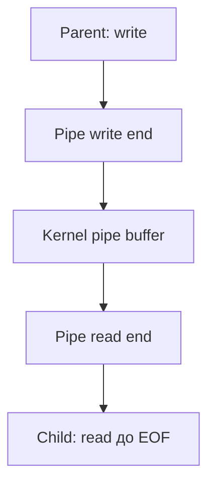
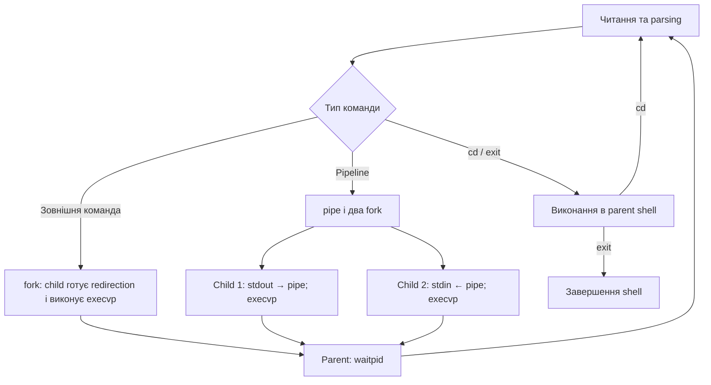

# Лабораторна робота №7
## Pipes, Redirection, Signals та Mini-Shell

**Курс:** Архітектура ЕОМ, операційні системи та системне програмування  
**Виконав:** Платонов Роман Віталійович

## 1. Мета роботи

Дослідити міжпроцесну взаємодію через anonymous pipes, перенаправлення
дескрипторів через dup2 та роботу із signals. Реалізувати mini-shell,
який запускає зовнішні команди, підтримує cd, exit, output redirection
та pipeline із двох команд.

## 2. Відтворення

З кореня репозиторію:

```bash
cd labs/lab07-ipc-shell
bash run.sh
```

Скрипт компілює дев’ять програм, виконує експерименти та зберігає
результати в `lab07-results.txt`.

Параметри компіляції:

```text
-std=c11 -D_POSIX_C_SOURCE=200809L -Wall -Wextra -O0
```

Окремий інтерактивний запуск mini-shell:

```bash
gcc -std=c11 -D_POSIX_C_SOURCE=200809L -Wall -Wextra -O0 \
    mini_shell.c -o /tmp/mini-shell-lab07
/tmp/mini-shell-lab07
```

У каталозі `traces/` збережені:

- `pipe-processes.strace` — trace взаємодії parent і child;
- `mini-shell.strace` — повний trace для вибраних категорій системних викликів;
- `mini-shell-session.txt` — команди та результати перевірок;
- `mini-shell-errors.txt` — результати помилкових команд;
- `ctrl-c-session.txt` — запис перевірки через псевдотермінал.

Виконувані файли та згенеровані output files автоматичних перевірок
створюються в тимчасовому каталозі поза репозиторієм.
Після завершення експериментів каталог видаляється.
Screenshots, executables, object files та core dumps не додаються.

## 3. Прогнози перед запуском

1. pipe поверне окремі descriptors для читання та запису.
2. Після fork обидва процеси успадкують обидва кінці pipe.
3. Якщо хоча б один write end залишається відкритим, порожній pipe
   не означатиме EOF.
4. dup2 дозволить перенаправити stdout без зміни виконуваної команди.
5. Для pipeline потрібно створити обидва child до очікування їх завершення.
6. SIGINT із власним handler не завершить signal_int; SIGKILL завершить.
7. Default SIGTERM завершить child, а власний handler дозволить
   виконати кероване завершення.
8. cd має змінювати каталог самого shell.
9. Невідома команда та переривання foreground command не повинні завершувати shell.

## 4. Створення pipe

Результат `pipe_basic.c`:

```text
Read end: 3
Write end: 4
Received: Hello through pipe!
Next read (EOF): 0
```

`pipefd[0]` — read end, `pipefd[1]` — write end.
У цьому запуску вони отримали номери 3 та 4.
Програма використовує значення, повернені pipe, а не фіксовані номери.

Pipe є kernel IPC-об’єктом, а не regular file.
До нього застосовуються read і write, оскільки він представлений
файловими дескрипторами. Звичайне позиціювання через lseek для pipe
не підтримується.

Після запису повідомлення write end закрито.
Після читання всіх даних наступний read повернув 0.

Pipe передає потік bytes, а не окремі повідомлення:
межі викликів write не гарантують відповідних меж read.

## 5. Pipe між parent і child

Результат `pipe_processes.c`:

```text
Before fork: read=3 write=4
Child received: Message from parent
Child: EOF
Parent: child status=0
```

### Descriptor map

| Етап | Parent | Child |
|---|---|---|
| Одразу після fork | FD 3 → read end; FD 4 → write end | FD 3 → read end; FD 4 → write end |
| Після закриття unused ends | FD 4 → write end; FD 3 закрито | FD 3 → read end; FD 4 закрито |
| Після передавання | FD 4 закрито; parent виконує waitpid | Child дочитує дані, отримує EOF та закриває FD 3 |

Parent передав `Message from parent\n`, тобто 20 bytes.
Child читав у циклі до EOF.



Перед fork stdout скидається через fflush, щоб накопичений
вивід не дублювався через копіювання stdio buffer у child.

## 6. Експеримент без close

У `pipe_no_close.c` child навмисно залишає власний write end відкритим,
хоча використовує pipe лише для читання.

Фактичний результат:

```text
Child received: Message from parent
No EOF: child still waiting; stopping and reaping child
Child signal=15
```

Повідомлення прочитано, але наступний read не отримав EOF:
у child залишився відкритий write end того самого pipe.

Parent через дві секунди перевірив child за допомогою
`waitpid(..., WNOHANG)`, після чого надіслав SIGTERM та виконав waitpid.
Це обмеження часу експерименту; воно не виправляє причину відсутності EOF.

У режимі `pipe_no_close --fixed` зайвий write end закривається:

```text
Child received: Message from parent
Child: EOF
Parent: child status=0
```

Умова EOF для ненульового запиту read:

**Буфер pipe порожній і всі references на write end закриті.**

Якщо pipe порожній, але writer ще існує, звичайний blocking read очікує.
Важливо враховувати всі копії descriptors, зокрема успадковані через fork
або створені через dup/dup2.

## 7. Аналіз pipe через strace

У trace parent має PID 18232, child — PID 18233.

Ключові записи:

```text
18232 pipe2([3, 4], 0) = 0
18232 clone(... SIGCHLD ...) = 18233
18232 close(3) = 0
18232 write(4, "Message from parent\n", 20) = 20
18233 read(3, "Message from parent\n", 128) = 20
18233 read(3, "", 128) = 0
18233 close(3) = 0
18233 +++ exited with 0 +++
```

Фрагмент скорочено: у повному trace закриття write ends та wait4
частково розділено на записи `unfinished` і `resumed`.

Відповідність C-коду:

| C-функція | Спостереження у trace |
|---|---|
| pipe | pipe2 створює FD 3 і 4 |
| fork | clone створює child |
| close | процеси закривають непотрібні ends |
| write | parent передає 20 bytes |
| read | child читає 20 bytes, потім отримує 0 |
| waitpid | wait4 отримує статус завершення child |

Після завершення child parent також отримав SIGCHLD.
`strace -f` дозволив спостерігати обидва процеси.

## 8. dup2 та output redirection

Результат `dup2_output.c`:

```text
redirected.txt: 'This goes to the file\n'
```

Descriptor map:

| Етап | FD 1 | Descriptor, повернений open |
|---|---|---|
| До dup2 | Початковий stdout | redirected.txt |
| Після dup2(fd, 1) | redirected.txt | redirected.txt |
| Після close(fd), якщо fd != 1 | redirected.txt | Закритий |

dup2 робить descriptor 1 посиланням на той самий відкритий файловий
опис, що й fd. Якщо descriptor 1 вже відкритий, його попереднє
призначення замінюється.

Закриття початкового fd не закриває descriptor 1.
Тому printf продовжує працювати зі stdout, але дані надходять у файл.

У автоматичному запуску початковий stdout перехоплює скрипт.
Тому його не слід без перевірки описувати як фізичний terminal.

## 9. exec із перенаправленням

`redirect_exec.c` виконала:

1. fork для створення child;
2. open для `ls-output.txt`;
3. dup2 для перенаправлення stdout;
4. close початкового descriptor;
5. execvp для `ls -l`;
6. waitpid у parent.

У `ls-output.txt` отримано список файлів робочого каталогу.
Сам `ls-output.txt` також потрапив до списку, оскільки був створений
до виконання ls.

Після успішного execvp старий код child не продовжується.
Повідомлення perror після execvp виконується лише при помилці,
після чого child завершується через `_exit(127)`.

## 10. Pipeline ls -l | wc -l

Результат окремої програми `pipeline.c`:

```text
12
Expected lines=12; Actual=12; Match=True
```

Порівняння з кількістю рядків звичайного `ls -l` підтвердило результат.

### Descriptor map

| Процес | Налаштування | Що закривається |
|---|---|---|
| Child 1: ls -l | FD 1 → pipe write end через dup2 | Обидва original pipe descriptors |
| Child 2: wc -l | FD 0 → pipe read end через dup2 | Обидва original pipe descriptors |
| Parent | Pipe не використовує | Обидва pipe descriptors до waitpid |

Обидва child створюються до очікування.
Вони можуть виконуватися concurrently: producer записує, consumer читає.

Якщо спочатку чекати producer, не запустивши consumer,
producer може заповнити pipe і заблокуватися.
Якщо parent залишить write end відкритим, consumer може не отримати EOF.

`wc -l` рахує рядки виводу, а не безпосередньо кількість файлів.
Для `ls -l` враховується також рядок `total`.

## 11. Експерименти із signals

### SIGINT і SIGKILL

`signal_int.c` встановлює handler через sigaction.

Результат:

```text
SIGINT received
Alive after SIGINT: True
After SIGKILL returncode= -9
```

SIGINT викликав handler, після якого програма продовжила працювати.
SIGKILL завершив процес.

У Python subprocess return code `-9` означає завершення сигналом 9,
а не код, який програма повернула з main.

Handler використовує write, а не printf, і зберігає errno.
write є async-signal-safe; stdio-функції можуть працювати
з внутрішнім станом і блокуваннями, не придатними для такого контексту.

### SIGTERM: default і власний handler

| Варіант | Результат | Статус, виведений parent |
|---|---|---:|
| Default SIGTERM | Child завершено сигналом 15 | 143 |
| Власний handler | Handler установив прапорець; child завершився нормально | 0 |

У default-випадку 143 — значення `128 + 15`, сформоване функцією
обробки статусу. Воно не означає, що child виконав `return 143`.

Для власного handler отримано:

```text
Child handler: SIGTERM received
Child: normal exit after handler
Parent: child status=0
```

Handler установлює `volatile sig_atomic_t` прапорець.
Очікування використовує sigsuspend. SIGTERM блокується до
налаштування handler, що запобігає втраті сигналу через race
між перевіркою прапорця та переходом до очікування.

### Порівняння signals

| Signal | Призначення та поведінка |
|---|---|
| SIGINT | Запит переривання, типовий результат Ctrl+C; можна обробляти або ігнорувати |
| SIGTERM | Запит завершення; можна обробити для керованого виходу |
| SIGKILL | Примусове завершення; не можна перехопити, ігнорувати або заблокувати |
| SIGCHLD | Повідомлення parent про зміну стану child, зокрема завершення |

kill надсилає signal. Наслідок визначається типом signal
та його disposition, а не лише назвою функції kill.

## 12. Архітектура mini-shell



У terminal shell показує `myshell>`.
Під час пакетного тестування prompt не виводиться,
оскільки stdin не є terminal.

Parser розділяє command line на argv.
Оператори `|` і `>` розпізнаються також без навколишніх пробілів.

Зовнішні команди запускаються через fork та execvp.
system та готовий shell parser не використовуються.

Перед exec child відновлює default behavior для SIGINT і SIGPIPE.
Parent закриває pipe descriptors та очікує обидва child.
waitpid повторюється після EINTR.

## 13. Built-ins cd та exit

`cd directory` виконує chdir у самому shell.

Фактична перевірка:

```text
pwd
/tmp/eom-lab07-gv4s_iza

cd /tmp
pwd
/tmp
```

Після цього shell повернувся до робочого каталогу через наступний cd.

Якби chdir виконувався лише в child, каталог parent shell не змінився б.
Саме тому cd реалізований як built-in.

exit завершує головний цикл самого shell. Запуск окремого child,
який одразу завершується, не завершив би parent shell.

## 14. Результати перевірок mini-shell

| Команда або перевірка | Фактичний результат |
|---|---|
| pwd | Показано поточний робочий каталог |
| ls і ls -l | Отримано список файлів |
| echo Hello Systems | `Hello Systems` |
| cd /tmp, потім pwd | `/tmp` |
| echo test > test.txt | Створено файл із `test\n` |
| cat test.txt | `test` |
| ls -l \| wc -l | `14` |
| cat input.txt \| grep hello | `hello one` та `hello two` |
| seq 100000 \| wc -l | `100000` |
| yes \| head -n 1 | `y`, writer завершився через SIGPIPE |
| exit | Shell нормально завершився |

Окрема програма pipeline дала 12 рядків, а пізніша перевірка
в mini-shell — 14. Між перевірками створено `input.txt` і `test.txt`,
тому вміст каталогу змінився. Це не розбіжність у реалізації pipe.

Великий pipeline із 100000 рядків завершився без зависання.
Це перевіряє одночасну роботу producer і consumer, а не лише
передавання повідомлення, яке повністю поміщається в pipe.

У `yes | head -n 1` reader завершується після першого рядка.
Подальший запис writer у pipe без readers спричинив SIGPIPE:

```text
y
Child signal=13
```

Shell продовжив роботу. Функція запуску pipeline повертає статус
правої команди; режим pipefail не реалізований.

## 15. Обробка помилок

Перевірено:

| Ситуація | Повідомлення |
|---|---|
| Неіснуюча команда | `execvp: No such file or directory` |
| Неіснуючий каталог для cd | `chdir: No such file or directory` |
| Redirection до неіснуючого каталогу | `open: No such file or directory` |
| Відсутня ліва або права команда pipe | `Syntax error` |
| Немає filename після > | `Syntax error` |
| Більше однієї pipe | `Syntax error` |
| cd без аргументу | `Usage: cd directory` |
| Надто довгий рядок | `Input too long` |

Після помилкових команд `echo still-running` вивела:

```text
still-running
```

Shell не завершився.

У журналі stdout і stderr пакетних перевірок друкуються окремими
блоками, тому їх розташування в тексті не є точним порядком
чергування системних викликів.

Перевірки результатів fork, pipe, open, dup2, execvp, chdir і waitpid
присутні в коді. Відмови fork/pipe через вичерпання ресурсів
штучно не викликалися.

## 16. Перевірка Ctrl+C

Тест виконано через псевдотермінал.
Скрипт передав символ ETX, який terminal обробляє як Ctrl+C
та перетворює на SIGINT для foreground process group.

Фактичний запис:

```text
myshell> sleep 30
^CChild signal=2
myshell> echo still-running
still-running
myshell>
```

Після цього скрипт передав exit і перевірив нормальне завершення shell.

Shell ігнорує SIGINT, а child перед exec відновлює SIG_DFL.
Тому sleep завершився сигналом 2, parent отримав його статус
і знову показав prompt.

Це спрощена foreground-модель: shell і команди використовують
спільну foreground process group. Повний job control не реалізовано.

## 17. Аналіз mini-shell через strace

### Output redirection

Ключові записи для `echo hello > output.txt`:

```text
18307 clone(... SIGCHLD ...) = 18308
18308 openat(AT_FDCWD, "output.txt", O_WRONLY|O_CREAT|O_TRUNC, 0644) = 3
18308 dup2(3, 1) = 1
18308 execve("/usr/bin/echo", ["echo", "hello"], ...) = 0
```

Parent виконує wait4 для child.
Після запуску перевірено, що output.txt містить `hello\n`.

Перед успішним execve видно багато спроб із ENOENT:
execvp перебирає каталоги PATH. Це очікуваний пошук executable,
а не доказ невдалого виконання всієї команди.

### Pipeline

Для `ls | wc -l` спостерігалися:

```text
18307 pipe2([3, 4], 0) = 0
18307 clone(... SIGCHLD ...) = 18309
18307 clone(... SIGCHLD ...) = 18310
18309 dup2(4, 1 <unfinished ...>
18310 dup2(3, 0) = 0
18310 execve("/usr/bin/wc", ["wc", "-l"], ...) = 0
18307 wait4(18310, <unfinished ...>
```

У trace також видно запуск ls і wait4 для першого child.
`unfinished/resumed` означає, що strace показує чергування
системних викликів різних процесів; це не повідомлення про помилку.

Вивід pipeline під strace становив 14 рядків.
Повний trace з close/read/write збережено в `traces/mini-shell.strace`;
у загальному журналі наведено вибрані ключові записи.

## 18. Межі реалізації

- Підтримується одна pipe між двома зовнішніми командами.
- Підтримується одне фінальне `> filename`.
- Built-ins cd та exit не підтримують pipe або redirection.
- Quotes, variable expansion, wildcard expansion, command substitution,
  background jobs, append і складні оператори shell не реалізовані.
- Використовується buffer рядка на 1024 bytes і максимум 128 tokens.
  Переповнення виявляється, надлишок довгого рядка відкидається.
- Програми очікують початково відкриті descriptors 0, 1, 2.
- Немає job control, pipefail та відтворення всіх exit-status правил Bash.
- Отримані результати підтверджують перевірені сценарії,
  але не є доказом відсутності всіх можливих помилок.

## 19. Контрольні питання

1. **Що таке IPC?**  
   Inter-process communication — механізми обміну даними та взаємодії між процесами.

2. **Що створює pipe()?**  
   Anonymous pipe і два descriptors для його read та write ends.

3. **Що означає pipefd[0]?**  
   Descriptor кінця pipe для читання.

4. **Що означає pipefd[1]?**  
   Descriptor кінця pipe для запису.

5. **Чому pipe працює через read і write?**  
   Він представлений дескрипторами та підтримує спільний I/O interface.

6. **Які descriptors отримує child після fork?**  
   Копії відкритих descriptors parent, що посилаються на ті самі
   відкриті файлові описи.

7. **Чому потрібно закривати unused pipe ends?**  
   Щоб звільнити ресурси та забезпечити правильну поведінку EOF і SIGPIPE.

8. **Коли read із pipe повертає EOF?**  
   За ненульового запиту — коли buffer порожній і всі write ends закриті.

9. **Що буде, якщо parent залишить write end відкритим?**  
   Reader може нескінченно очікувати нові дані замість отримання EOF.

10. **Що робить dup2()?**  
    Налаштовує заданий descriptor як посилання на той самий відкритий
    файловий опис, що й source descriptor.

11. **Як реалізується >?**  
    Файл відкривається для запису, його descriptor дублюється на stdout,
    зайвий descriptor закривається, після чого виконується команда.

12. **Чому команда не повинна знати про redirection?**  
    Вона продовжує писати у FD 1; змінюється ресурс цього descriptor.

13. **Як побудувати program1 | program2?**  
    Створити pipe і два child, під’єднати stdout першого та stdin другого
    до відповідних ends, закрити зайві descriptors і виконати exec.

14. **Який descriptor першої програми підключається до pipe?**  
    stdout, FD 1, до write end.

15. **Який descriptor другої програми підключається до pipe?**  
    stdin, FD 0, до read end.

16. **Що таке signal?**  
    Механізм повідомлення процесу або потоку про подію,
    який може спричинити default action або виклик handler.

17. **Чим signal відрізняється від pipe?**  
    Signal повідомляє про подію; pipe передає потік bytes.
    Це різні способи взаємодії з різною семантикою.

18. **Що робить kill()?**  
    Надсилає вказаний signal процесу або групі процесів відповідно до аргументів.

19. **Чим SIGTERM відрізняється від SIGKILL?**  
    SIGTERM можна обробити чи ігнорувати; SIGKILL не дозволяє
    користувацькому коду перехопити завершення.

20. **Чому не можна catch SIGKILL?**  
    ОС резервує його як механізм завершення без участі handler процесу.

21. **Що таке SIGINT?**  
    Signal переривання, який terminal зазвичай надсилає foreground group при Ctrl+C.

22. **Чому printf не є загальним вибором для signal handler?**  
    Він не є async-signal-safe та може працювати з перерваним
    внутрішнім станом stdio або блокуваннями.

23. **Що таке async-signal-safe function?**  
    Функція, яку дозволено викликати з асинхронного signal handler
    відповідно до гарантій POSIX.

24. **Чому shell є user-space program?**  
    Він організовує запуск команд через публічні системні виклики,
    а не сам реалізує механізми kernel.

25. **Що робить fork у shell?**  
    Створює child, у якому можна налаштувати descriptors і запустити команду.

26. **Що робить exec?**  
    Замінює образ поточного процесу новою програмою, зберігаючи його PID.
    Після успіху старий код не продовжується.

27. **Для чого waitpid?**  
    Очікує потрібний child, отримує його статус і дозволяє прибрати
    збережений kernel запис про завершення.

28. **Чому cd має бути built-in?**  
    Щоб змінити working directory самого shell, а не лише окремого child.

29. **Чому exit виконується самим shell?**  
    Потрібно завершити shell, а не створити та завершити ще один процес.

30. **Чому system не підходить для цієї роботи?**  
    Він передає виконання іншому shell і приховує механізми,
    які потрібно реалізувати самостійно.

31. **Що відбувається з descriptors після exec?**  
    Зазвичай вони залишаються відкритими; descriptors із FD_CLOEXEC
    закриваються при успішному exec.

32. **Як fork, pipe та dup2 разом створюють pipeline?**  
    Pipe створює канал, fork передає descriptors дочірнім процесам,
    dup2 підключає їхні стандартні потоки до цього каналу.

33. **Чому pipeline processes можуть виконуватися concurrently?**  
    Обидва child створюються до wait; ОС планує їх незалежно,
    а buffer pipe дозволяє producer і consumer просуватися узгоджено.

34. **Що буде, якщо reader завершився, а writer пише?**  
    Якщо всі read ends закриті, запис спричиняє SIGPIPE.
    Якщо signal не завершує процес, write може повернути -1 з EPIPE.

35. **Що parent закриває після створення pipeline?**  
    Обидва власні pipe descriptors; потім очікує обидва child.

## 20. Висновок

Реалізовано передавання bytes через pipe, перенаправлення stdout
за допомогою dup2 та pipeline між двома процесами.
Експеримент підтвердив, що незакритий write end заважає отриманню EOF.

Досліджено default behavior і handlers signals.
Mini-shell запускає команди через fork/execvp, підтримує cd, exit,
output redirection та одну pipe, обробляє перевірені помилки
і продовжує роботу після Ctrl+C.

Результати strace узгоджуються з реалізацією:
створення процесів, налаштування descriptors, exec, передавання даних,
закриття ресурсів і очікування завершення.
